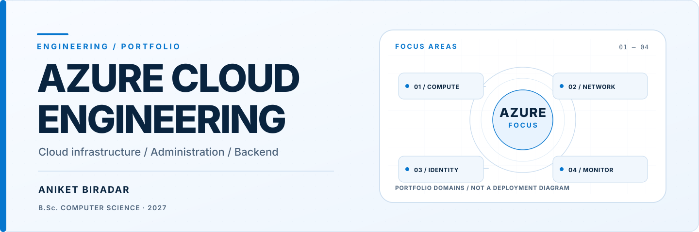
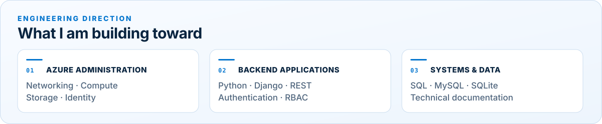
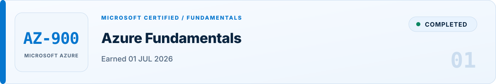
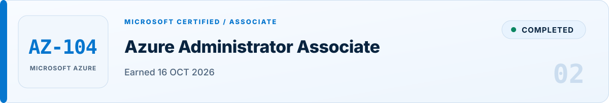
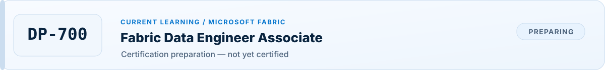
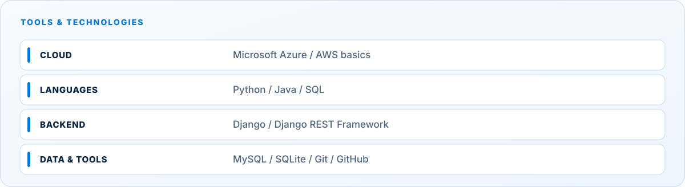
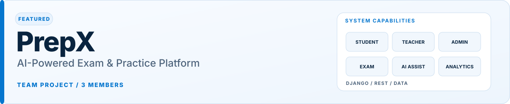
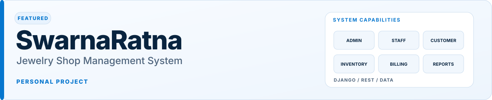
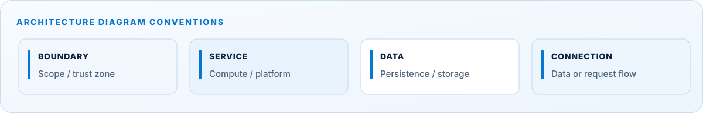
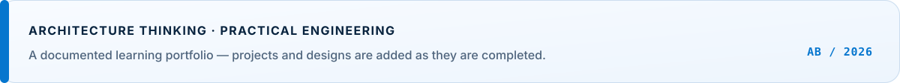

<!--
  Azure Cloud Engineering Portfolio / Aniket Biradar
  Design: Azure Engineering Editorial (light and dark theme SVG assets)
  The repository is foundational. Do not confuse certification knowledge or
  backend projects with demonstrated Azure production deployments.
-->

<picture>
  <source media="(prefers-color-scheme: dark)" srcset="./assets/banner-dark.svg" />
  <source media="(prefers-color-scheme: light)" srcset="./assets/banner-light.svg" />
  
</picture>

  <a href="https://github.com/aniketbiradar-official"><b>GITHUB PROFILE</b></a>
  &nbsp;&nbsp; · &nbsp;&nbsp;
  <a href="https://aniketbiradar.site/"><b>PERSONAL WEBSITE</b></a>
  &nbsp;&nbsp; · &nbsp;&nbsp;
  <a href="https://www.linkedin.com/in/aniket-biradar-a6b775371/"><b>LINKEDIN</b></a>

Cloud Engineering · Microsoft Azure Administration · Backend Development

---

  <a href="#overview">Overview</a> &nbsp;·&nbsp;
  <a href="#credentials">Credentials</a> &nbsp;·&nbsp;
  <a href="#technical-capabilities">Capabilities</a> &nbsp;·&nbsp;
  <a href="#engineering-work">Engineering Work</a> &nbsp;·&nbsp;
  <a href="#architecture--documentation">Architecture</a> &nbsp;·&nbsp;
  <a href="#learning-resources">Resources</a> &nbsp;·&nbsp;
  <a href="#current-development">Current Development</a>

## Overview

I'm **Aniket Biradar**, a **B.Sc. Computer Science** student at **COCSIT, Latur** (class of **2027**). This repository is my dedicated workspace for documenting **Microsoft Azure administration**, cloud infrastructure concepts, architecture studies, and practical engineering work as they are completed.

My development background includes **Python, Java, Django, REST APIs, and relational databases**. I am expanding that foundation toward cloud and backend engineering, with emphasis on understanding system boundaries, access control, data flows, and maintainable documentation.

<picture>
  <source media="(prefers-color-scheme: dark)" srcset="./assets/sections/focus-dark.svg" />
  <source media="(prefers-color-scheme: light)" srcset="./assets/sections/focus-light.svg" />
  
</picture>

## Credentials

My completed certifications are listed below with the original earned dates. **These custom cards are portfolio graphics, not official Microsoft badge artwork.**

### Completed · Microsoft Azure

<picture>
  <source media="(prefers-color-scheme: dark)" srcset="./assets/certifications/az-900-dark.svg" />
  <source media="(prefers-color-scheme: light)" srcset="./assets/certifications/az-900-light.svg" />
  
</picture>

<picture>
  <source media="(prefers-color-scheme: dark)" srcset="./assets/certifications/az-104-dark.svg" />
  <source media="(prefers-color-scheme: light)" srcset="./assets/certifications/az-104-light.svg" />
  
</picture>

> **Credential details:** AZ-900 earned **July 1, 2026**; AZ-104 earned **October 16, 2026** and expires **October 17, 2027**, according to the supplied Microsoft Learn screenshots. Public credential verification links will be added only after valid sharing URLs are confirmed. The original screenshots are deliberately excluded from the public upload package because they expose credential identifiers.

### In preparation · Microsoft Fabric

<picture>
  <source media="(prefers-color-scheme: dark)" srcset="./assets/certifications/dp-700-learning-dark.svg" />
  <source media="(prefers-color-scheme: light)" srcset="./assets/certifications/dp-700-learning-light.svg" />
  
</picture>

## Technical Capabilities

<picture>
  <source media="(prefers-color-scheme: dark)" srcset="./assets/sections/toolkit-dark.svg" />
  <source media="(prefers-color-scheme: light)" srcset="./assets/sections/toolkit-light.svg" />
  
</picture>

| Area | Technology or experience |
| :--- | :--- |
| **Cloud** | Microsoft Azure; AWS fundamentals |
| **Programming** | Python, Java, SQL |
| **Backend** | Django, Django REST Framework, REST APIs |
| **Databases** | MySQL, SQLite |
| **Development tools** | Git, GitHub, VS Code, PyCharm |
| **Project technologies** | Bootstrap, Chart.js, ReportLab, Gemini API |

*These reflect certification study, academic learning, and project work—not a claim of advanced professional expertise across every technology.*

### Cloud engineering areas of study

- **Administration:** compute, storage, identity, monitoring and resource management.
- **Connectivity and security:** virtual networking, access controls, and cloud security fundamentals.
- **Engineering workflows:** clear documentation, repeatable configurations, and practical evaluation of architectural trade-offs.

These describe my **learning focus**. They are not presented as completed Azure deployments.

## Engineering Work

I also build backend applications. The two repositories below demonstrate application-layer engineering; neither is being presented here as a completed Azure cloud deployment.

<a href="https://github.com/PrepX-Team/PrepX">
<picture>
  <source media="(prefers-color-scheme: dark)" srcset="./assets/projects/prepx-dark.svg" />
  <source media="(prefers-color-scheme: light)" srcset="./assets/projects/prepx-light.svg" />
  
</picture>
</a>

**PrepX — AI-Powered Online Exam & Practice Platform** · *Team project (3 members)*

Python · Django · Django REST Framework · SQLite · Bootstrap · Chart.js · ReportLab · Gemini API

- Implemented session-based authentication and RBAC for **Student, Teacher, and Admin** roles.
- Built **Subject, Topic, and Question Bank REST APIs** with ownership rules, difficulty levels, validation, search and filtering.
- Integrated **Gemini API** for AI-assisted question generation and personalized learning recommendations.
- Developed timed exam and practice workflows with test unlocking, auto-save, randomization, negative marking and automatic evaluation.
- Implemented teacher exam management, analytics, certificates and CSV/Excel reporting.

[**Explore PrepX repository**](https://github.com/PrepX-Team/PrepX)

 

<a href="https://github.com/aniketbiradar-official/jewelry-shop-management">
<picture>
  <source media="(prefers-color-scheme: dark)" srcset="./assets/projects/swarnaratna-dark.svg" />
  <source media="(prefers-color-scheme: light)" srcset="./assets/projects/swarnaratna-light.svg" />
  
</picture>
</a>

**SwarnaRatna — Jewelry Shop Management System** · *Personal project*

Python · Django · Django REST Framework · MySQL · Bootstrap · Chart.js · ReportLab

- Developed role-based access control for **Admin, Staff, and Customer**, using middleware, decorators and template authorization checks.
- Built inventory features for SKU, metal/purity information, stock deduction, low-stock alerts and soft-delete protection.
- Implemented REST endpoints and transactional billing with dynamic pricing, GST, stock updates and PDF invoice generation.
- Enforced customer data isolation for orders, invoices and repair records.
- Applied Django transactions, CSRF protection, session security and input validation; created analytics and CSV/Excel reports.

[**Explore SwarnaRatna repository**](https://github.com/aniketbiradar-official/jewelry-shop-management)

## Architecture & Documentation

This repository is structured to host reproducible Azure labs, architecture diagrams and related technical notes **once those materials have been implemented and documented**.

<picture>
  <source media="(prefers-color-scheme: dark)" srcset="./assets/sections/diagram-legend-dark.svg" />
  <source media="(prefers-color-scheme: light)" srcset="./assets/sections/diagram-legend-light.svg" />
  
</picture>

- [Diagram design and export conventions](./docs/diagram-style-guide.md)
- [Editable draw.io style template](./diagrams/diagram-style-template.drawio) — illustrative only, **not an implemented Azure architecture**.
- [Visual identity and asset specification](./docs/visual-identity.md)

Azure-specific projects will be linked here when they have verifiable repositories, architecture explanations and documented implementation details. No placeholder project is marked as completed.

## Learning Resources

I maintain a compact, curated collection of official Microsoft Learn material that connects Azure certification topics to administration, architecture, security, and backend development.

**[Explore the Azure & Microsoft Fabric learning resource index →](./resources/README.md)**

The guides include [Azure Fundamentals](./resources/azure-fundamentals.md), [Azure Administration](./resources/azure-administration.md), [Azure Architecture](./resources/azure-architecture.md), [Cloud Security](./resources/cloud-security.md), [Backend & Cloud Integration](./resources/backend-and-cloud.md), and [Microsoft Fabric / DP-700 preparation](./resources/microsoft-fabric.md).

Some official documentation links contain my Microsoft Student Ambassadors Registered Member Contributor ID for transparent referral attribution; no credit or visitor totals are claimed.

## Current Development

- **DP-700 preparation:** Learning Microsoft Fabric data engineering concepts.
- **Azure administration:** Building on completed AZ-900 and AZ-104 certification study.
- **Backend engineering:** Continuing Python/Django application development and technical documentation.

I am a **Microsoft Student Ambassadors Registered Member**, currently pursuing the **Community Influencer** engagement path. This is a participation status, not a claim of full ambassador onboarding or program endorsement.

---

<picture>
  <source media="(prefers-color-scheme: dark)" srcset="./assets/sections/footer-dark.svg" />
  <source media="(prefers-color-scheme: light)" srcset="./assets/sections/footer-light.svg" />
  
</picture>

<a href="https://github.com/aniketbiradar-official">GitHub Profile</a> &nbsp;·&nbsp;
<a href="https://aniketbiradar.site/">Portfolio Website</a> &nbsp;·&nbsp;
<a href="https://www.linkedin.com/in/aniket-biradar-a6b775371/">LinkedIn</a>

Personal technical portfolio · Not affiliated with or endorsed by Microsoft

